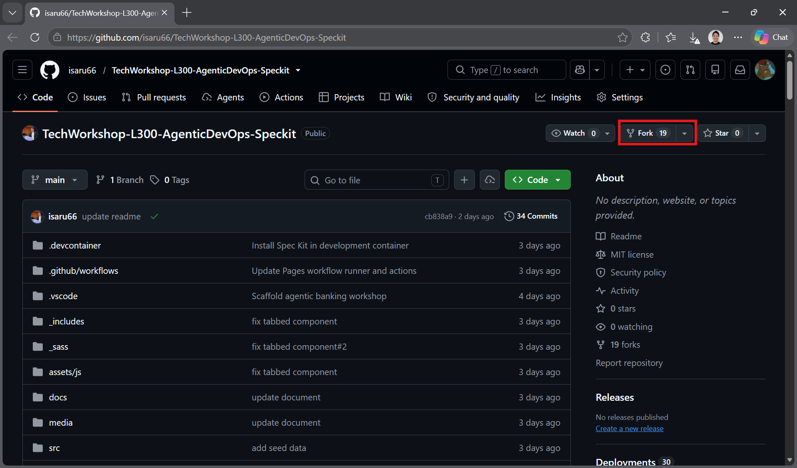
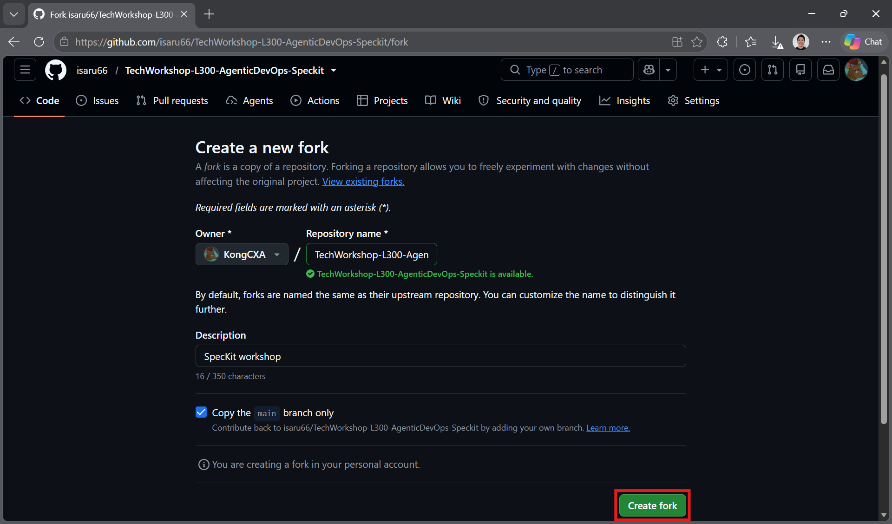
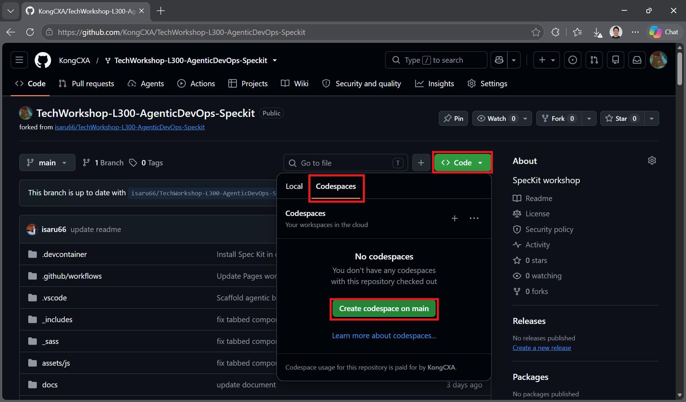
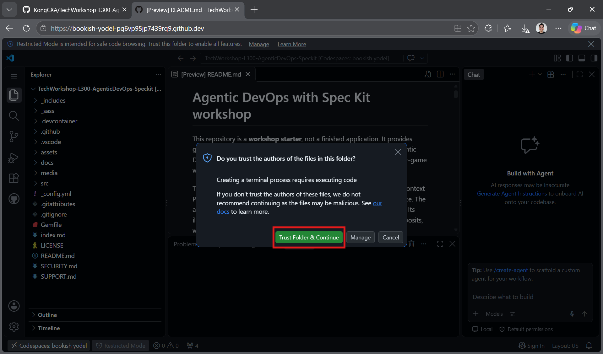

# Task 01 - Set up GitHub Codespaces

## Introduction

GitHub Codespaces is an alternative to installing the development tools locally. Create a Codespace from your own fork to work in a browser-based VS Code environment with the workshop development container.

## Description

Sign in with your **personal GitHub account**, fork the workshop repository into that account, then create a Codespace from your fork.

{: .important }
> You must use a personal GitHub account to fork the repository, not an enterprise managed account. Make sure the fork's **Owner** is your own personal account.

## Success Criteria

- The workshop repository is forked into your personal GitHub account.
- A Codespace is running from your fork's `main` branch.
- Development-container setup has finished and the workspace is ready.
- Forwarded application ports remain private.

## Learning Resources

- [Fork a repository](https://docs.github.com/en/get-started/quickstart/fork-a-repo)
- [Create a Codespace for a repository](https://docs.github.com/en/codespaces/developing-in-a-codespace/creating-a-codespace-for-a-repository)

## Key Tasks

### 01: Open the repository and click Fork

Sign in to GitHub with your personal account and open the workshop repository.

<strong>Expand this section to view the solution</strong>

1. Sign in at [github.com](https://github.com) using your **personal GitHub account**.
2. Open [the workshop repository](https://github.com/isaru66/TechWorkshop-L300-AgenticDevOps-Speckit).
3. Click **Fork** near the top-right corner of the repository page.

If you already have a fork in your personal account, open that fork and continue to creating a Codespace.

### 02: Create the fork in your personal account

Confirm the fork owner before creating your copy.

<strong>Expand this section to view the solution</strong>

1. On **Create a new fork**, make sure **Owner** is your personal GitHub account, not an organization.
2. Keep the repository name or choose a name for your workshop copy.
3. Leave **Copy the main branch only** selected.
4. Click **Create fork**.

The account shown in the screenshot is only an example. Select your own personal account. After creation, confirm the repository appears under your username and is marked as forked from the workshop repository.

### 03: Create a Codespace from your fork

Open your fork and create a new Codespace on `main`.

<strong>Expand this section to view the solution</strong>

1. In **your fork**, click the green **Code** button.
2. Select the **Codespaces** tab.
3. Click **Create codespace on main**.
4. Wait for browser-based VS Code to open and for development-container setup to finish.

5. After the Codespace opens, click **Trust Folder & Continue** when prompted for your workshop fork.

Codespaces requires available quota or billing allowance on your account. Review any usage or billing notice before continuing. Creating the Codespace checks out your fork automatically; you do not need to clone it again inside the Codespace.

### 04: Verify the workspace

Wait for setup to complete before running workshop commands. The repository's development container configures the tools and extensions described in the [Exercise 01 overview](../01_setup_development_environment/01_setup_development_environment.md#choose-your-environment).

You can skip local software installation in [Task 02](../01_setup_development_environment/01_02.md) and continue to [Task 03 - Check GitHub Copilot access](../01_setup_development_environment/01_03.md). Spec Kit workspace initialization is still required in Exercise 03.

{: .warning }
> Keep forwarded application ports **private**. The banking demo has no application authentication; Codespaces access controls do not make public REST, MCP, or database endpoints safe.
