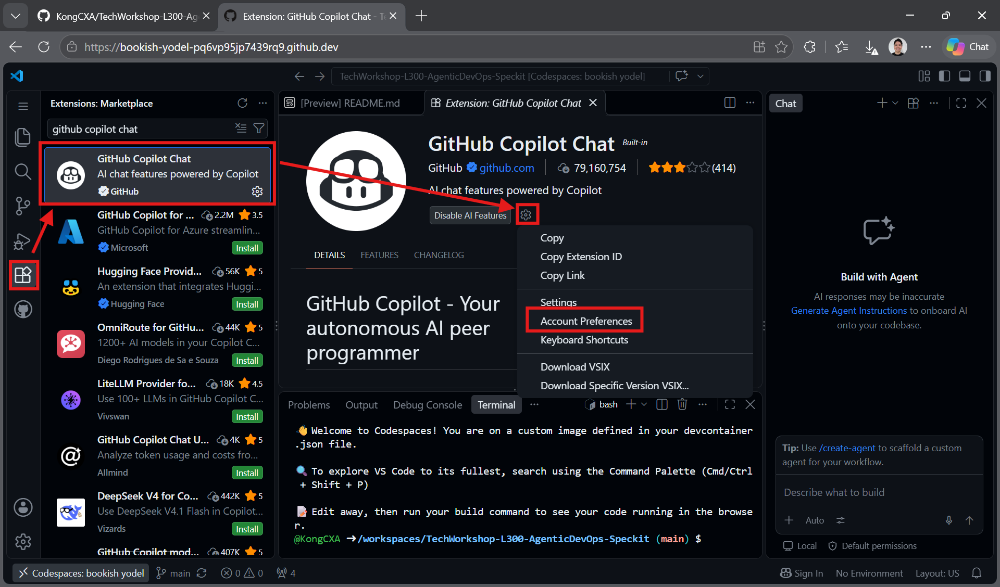
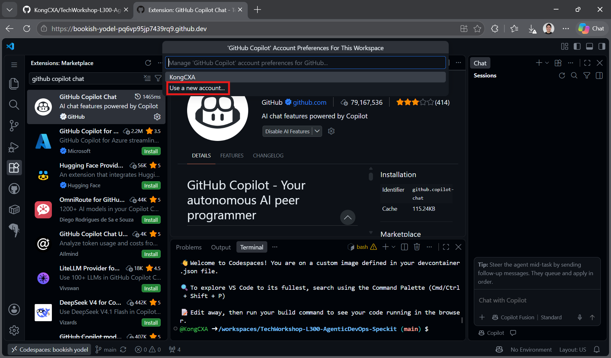
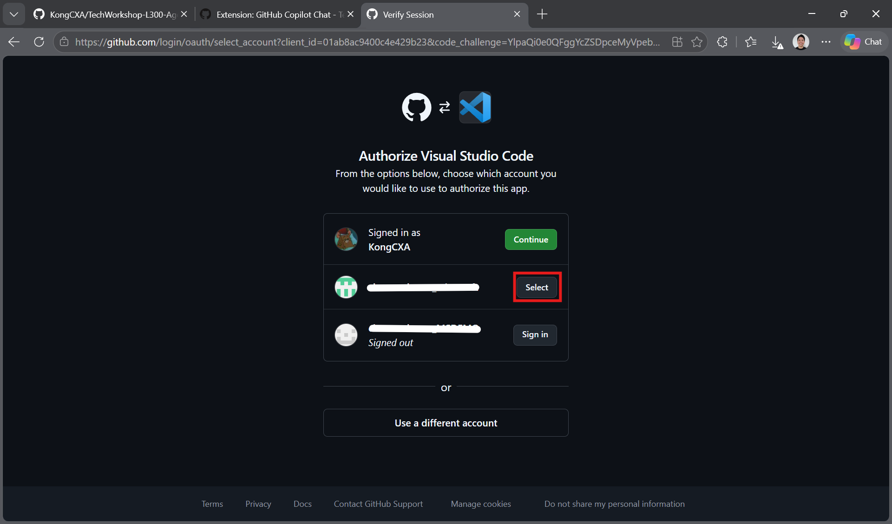
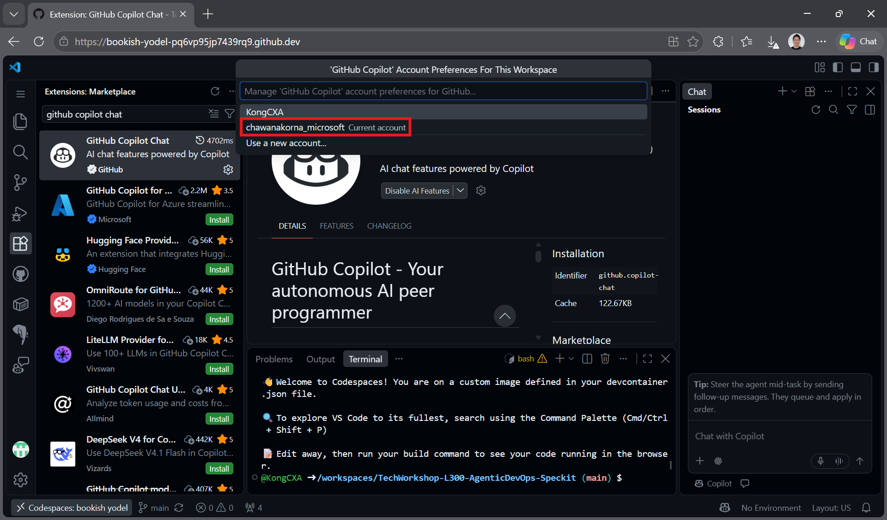
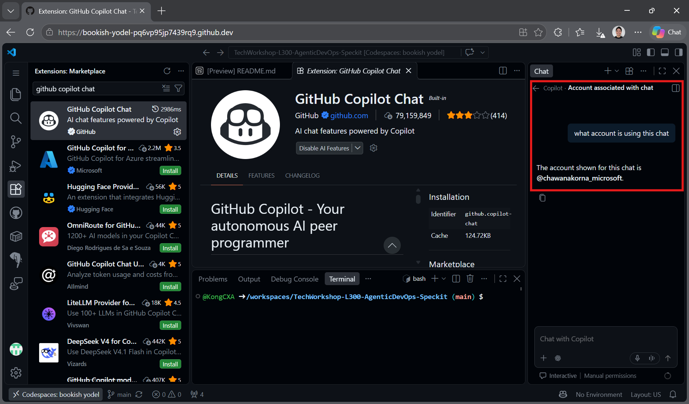

# Task 02 - Use your enterprise account for Copilot Chat

## Introduction

Keep your personal GitHub account for the repository fork and Codespace, but use your enterprise GitHub account for Copilot Chat.

## Description

Change the GitHub Copilot Chat extension's account preference in your Codespace to use your enterprise account's organization-provided Copilot access and usage allowance instead of your personal account's allowance.

{: .important }
> Your enterprise account must already have Copilot access assigned by your organization. Switching accounts does not grant access or additional credits; available usage depends on your organization's plan and policies.

## Success Criteria

- Your enterprise GitHub account is signed in for Copilot Chat.
- **Account Preferences** marks your enterprise account as **Current account**.
- Copilot Chat responds to a test message.
- Your repository fork and Codespace remain under your personal account.

## Key Tasks

### 01: Open Copilot Chat account preferences

Find the extension's account settings in your Codespace.

<details markdown="block">
<summary><strong>Expand this section to view the solution</strong></summary>

1. Click **Extensions** in the activity bar.
2. Search for `github copilot chat`.
3. Click the **GitHub Copilot Chat** extension published by GitHub.
4. Click the **gear** icon, then select **Account Preferences**.



</details>

### 02: Add a new account

Start switching Copilot Chat from your personal account to your enterprise account.

<details markdown="block">
<summary><strong>Expand this section to view the solution</strong></summary>

1. An account picker opens at the top of VS Code.
2. If you have only signed in with your personal account, that will be the only account listed.
3. Click **Use a new account...** to sign in with your enterprise account.



If your enterprise account is already listed, select it instead.

</details>

### 03: Select your enterprise GitHub account

Authorize VS Code using the account that has your organization's Copilot access.

<details markdown="block">
<summary><strong>Expand this section to view the solution</strong></summary>

1. On the GitHub authorization page, find your **enterprise GitHub account** and click **Select**.
2. If it is not listed, click **Use a different account** and sign in with your enterprise account.
3. Complete any required sign-in, organization SSO, and authorization prompts, then return to your Codespace.



The accounts shown in the screenshots are examples. Choose your own enterprise account, not the personal account used to create your fork.

</details>

### 04: Verify the account used by Copilot Chat

Check the account preference again and send a test message.

<details markdown="block">
<summary><strong>Expand this section to view the solution</strong></summary>

1. Open **GitHub Copilot Chat** > **gear** > **Account Preferences** again.
2. Confirm your enterprise account is marked **Current account**.



3. Open Copilot Chat and send this test message:

```text
What account is this chat using?
```



Responses may vary. Use **Account Preferences**, not the generated chat answer, to confirm the selected account. A chat response alone does not verify the account's billing or remaining allowance.

</details>
