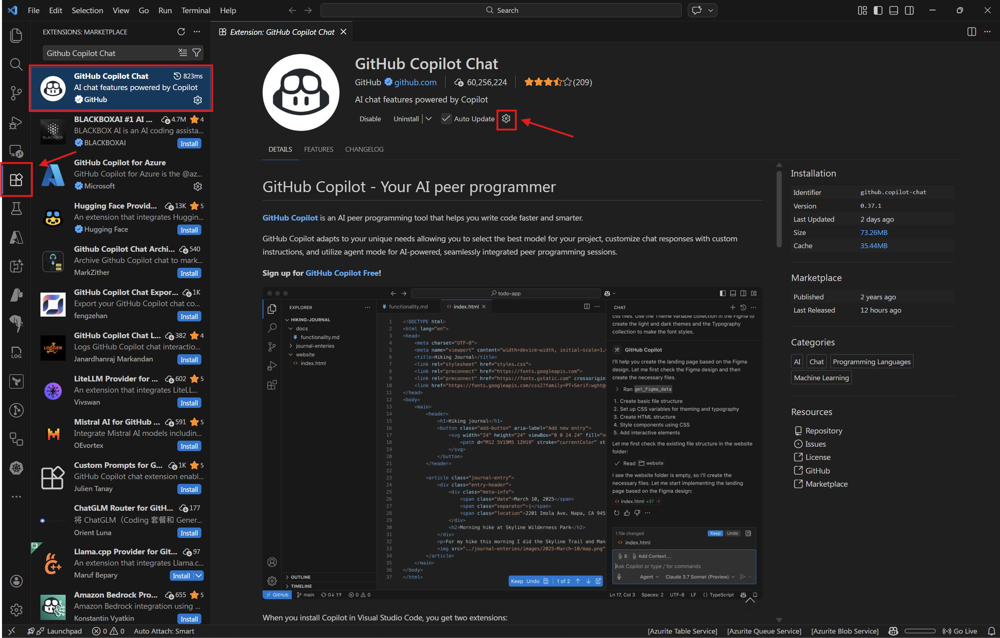
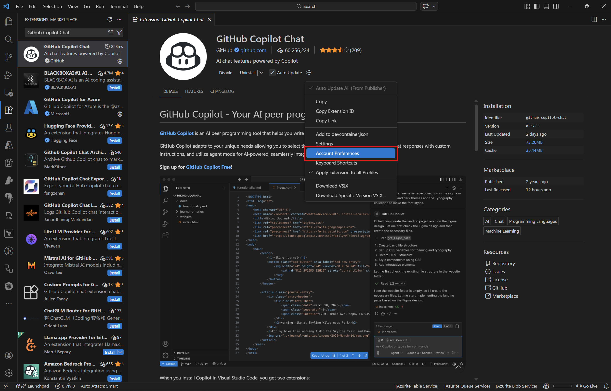
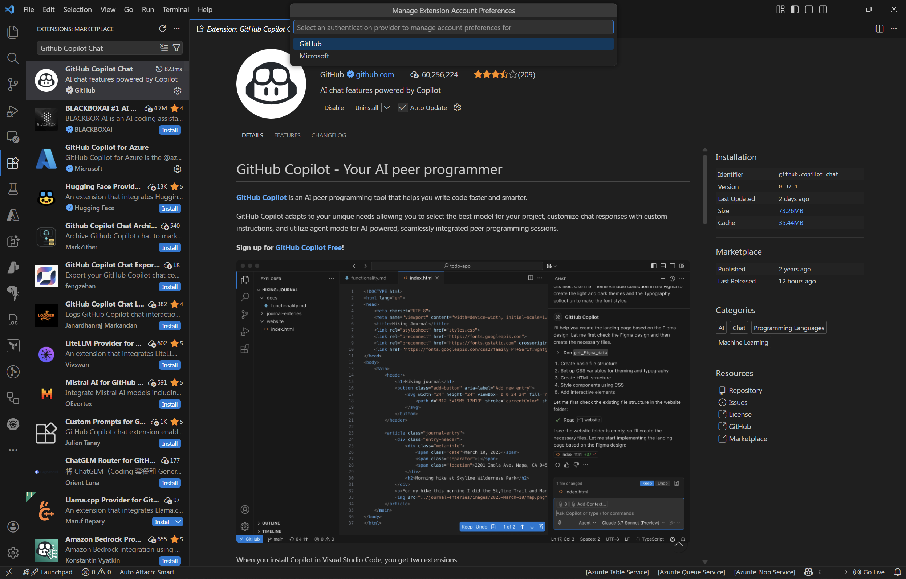
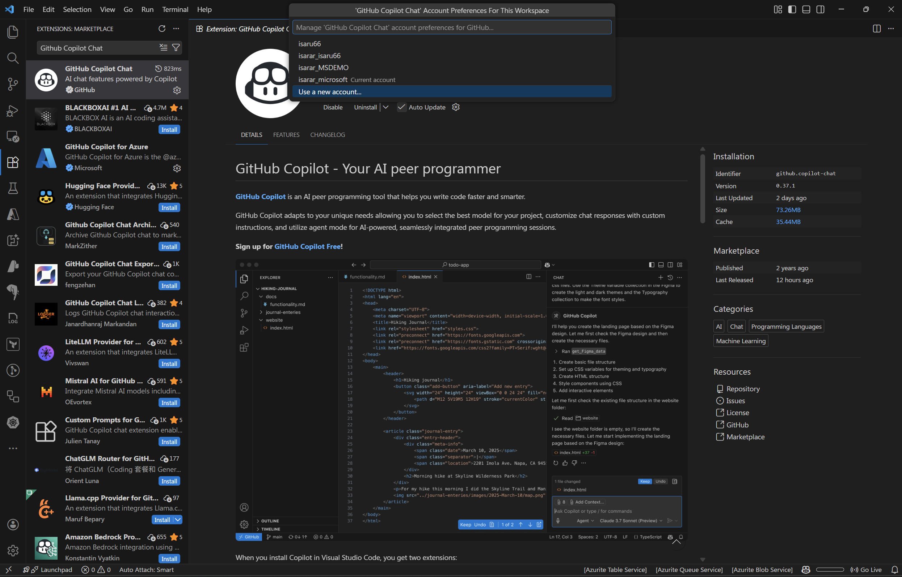
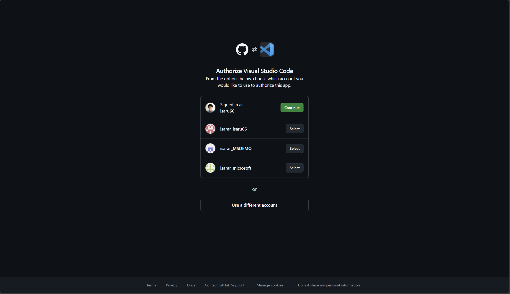
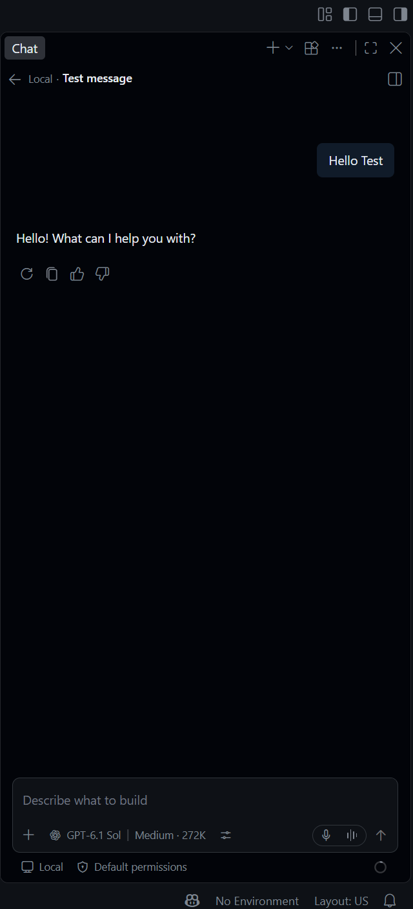

# Task 03 - Check GitHub Copilot access

Use your GitHub account with Copilot access, then send a test message in Copilot Chat.

If you are already signed in with the correct account, skip to **Test GitHub Copilot**.

<strong>Select or sign in with your Copilot account</strong>

1. In VS Code or your Codespace, open **Extensions**, search for **GitHub Copilot Chat**, and open its extension page. Click the **gear icon**.

   

2. Select **Account Preferences**.

   

3. Select **GitHub**.

   

4. Choose your account with Copilot access, or select **Use a new account...** to sign in.

   

5. If the browser opens, select your account and click **Continue**, or choose **Use a different account**. Follow the prompts to finish signing in.

   

## Test GitHub Copilot

Open **Copilot Chat**, send **Hello Test**, and confirm that Copilot replies. The wording of the reply may differ from the screenshot.

If you cannot sign in or receive a reply, follow the [official Copilot setup guide](https://code.visualstudio.com/docs/setup/copilot) or ask your instructor for help.
