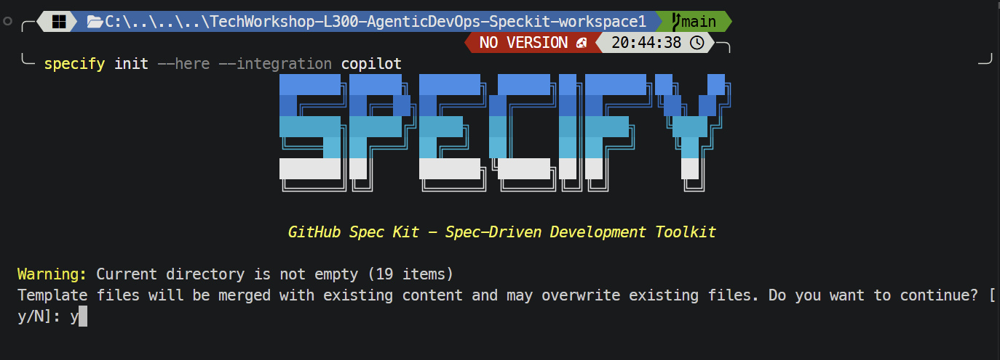
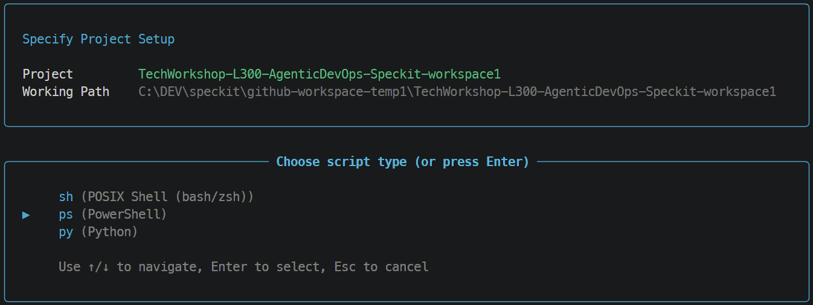
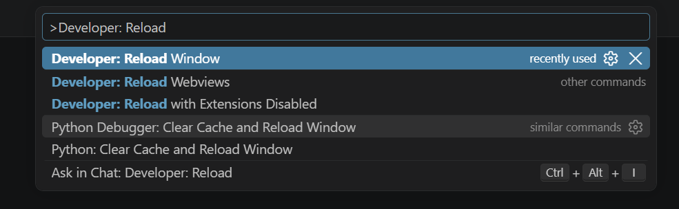
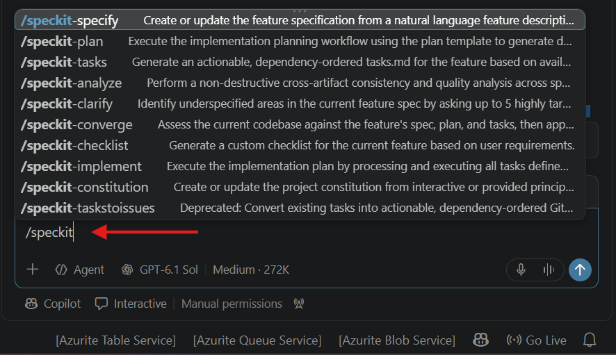

# Task 02 - Initialize Spec Kit

## Introduction

The CLI installation does not initialize the workshop repository. Each participant performs that setup.

## Description

Initialize Spec Kit in your own non-empty workshop workspace for the GitHub Copilot integration, then review the resulting changes.

## Success Criteria

- You have run `specify init` in the intended workspace.
- You have reviewed the generated project and integration files.
- The Spec Kit skills appear in GitHub Copilot Chat.

## Learning Resources

- [Adopting Spec Kit in an existing project](https://github.github.io/spec-kit/guides/existing-projects.html)

## Key Tasks

### 1. Prepare the workspace

Open your own workshop workspace in VS Code. Review the upstream existing-project guidance, establish a reviewable baseline, and back up any files that could conflict. Run the following in the terminal to identify existing changes:

```bash
git status --short
```

### 2. Initialize the GitHub Copilot integration

From the workspace root, run:

```bash
specify init --here --integration copilot
```

`--here` initializes the current directory, and `--integration copilot` selects GitHub Copilot. Because the workshop workspace is not empty, the CLI warns that template files will be merged and may overwrite existing files. Confirm that you are in the correct workspace and have preserved existing work before entering `y` to continue.



Use the interactive confirmation shown above rather than adding `--force`, which skips that confirmation. If you cannot safely preserve conflicting files, cancel and resolve those conflicts first.

### 3. Choose the script type

When prompted, use the arrow keys to select the script type, then press **Enter**:

- **Windows PowerShell:** Select `ps (PowerShell)`, as shown in the screenshot.
- **macOS, Linux, or GitHub Codespaces with bash/zsh:** Select `sh (POSIX Shell (bash/zsh))`.
- **Python scripts:** The CLI also offers `py (Python)`; choose it only if you intend to use Python-based scripts.



The project name and working path should identify your own workspace, not necessarily the example shown. Wait for initialization to complete successfully.

### 4. Review the generated changes

Inspect the new files and changes before continuing:

```bash
git status --short
git diff
```

Review new, untracked files in VS Code as well; `git diff` does not display their contents. Check the generated Spec Kit configuration and Copilot integration files, and resolve any unintended replacements before proceeding.

### 5. Reload VS Code

Save your work, open the Command Palette with **Ctrl+Shift+P** on Windows/Linux or **Cmd+Shift+P** on macOS, and run **Developer: Reload Window** so VS Code can discover the generated integration.



### 6. Verify the Spec Kit skills

Open GitHub Copilot Chat in **Agent** mode and type `/speckit` to display the available skills. Confirm that entries such as `/speckit-specify`, `/speckit-plan`, `/speckit-tasks`, and `/speckit-constitution` appear. You only need to inspect the list at this stage, not run a skill.



If the entries do not appear, confirm that initialization completed in the workspace you currently have open, review the generated integration files, and reload the window again. Continue to [Task 03 - Explore the spec-driven workflow](./03_03.md) once the skills are available.
