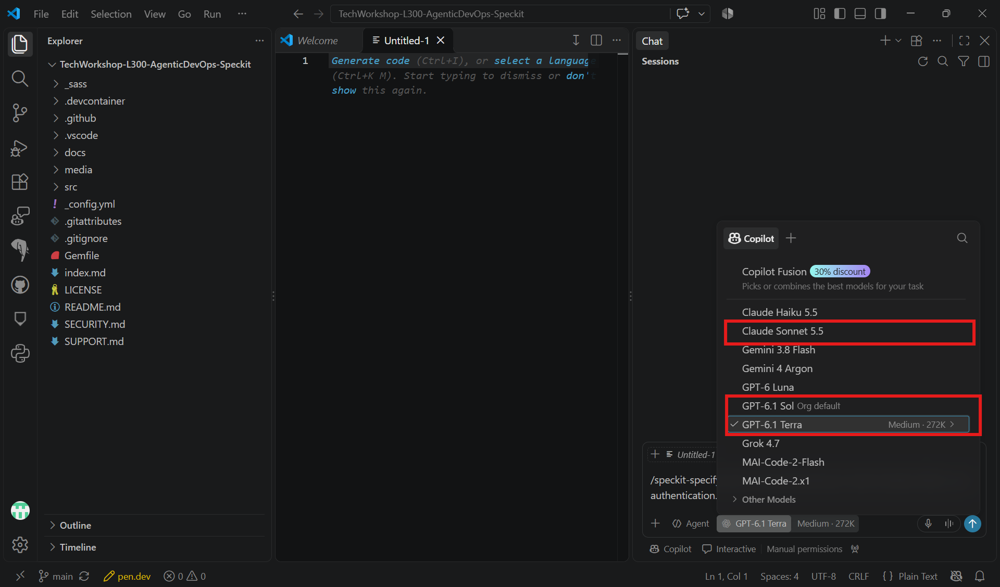
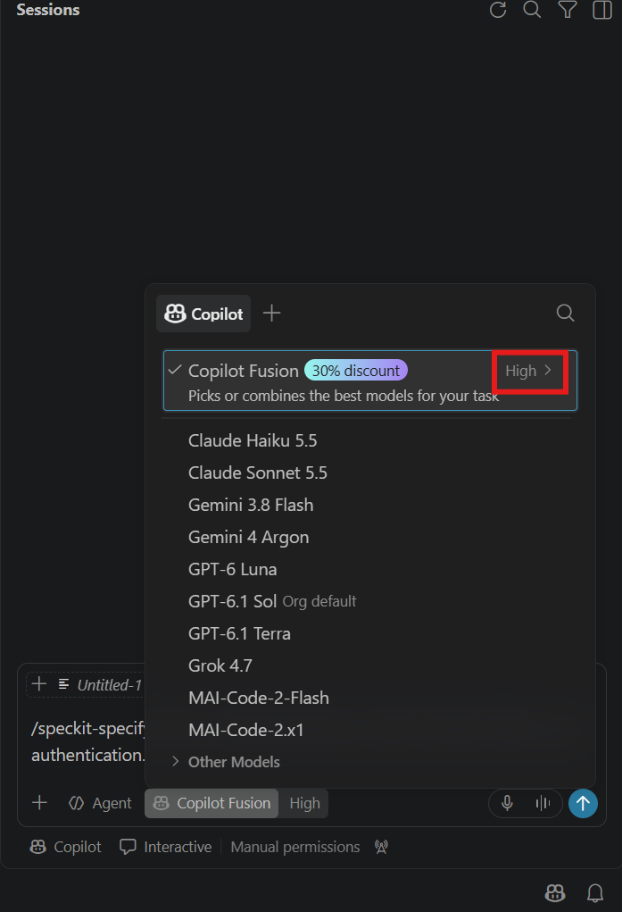
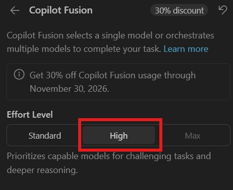
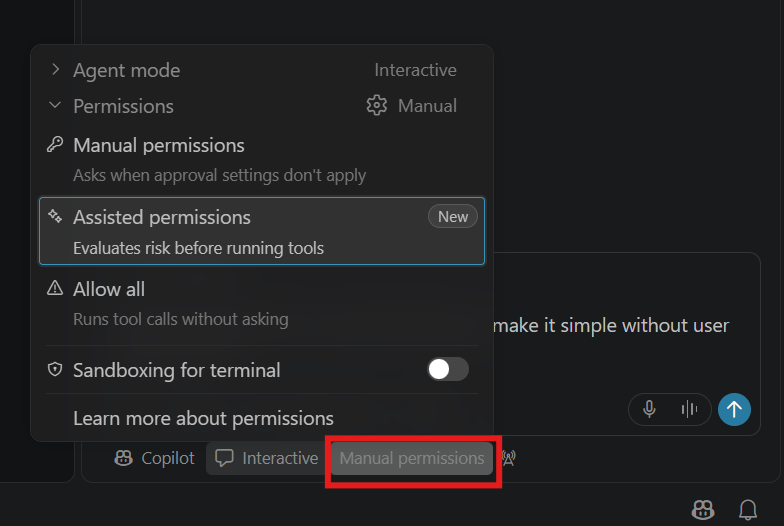
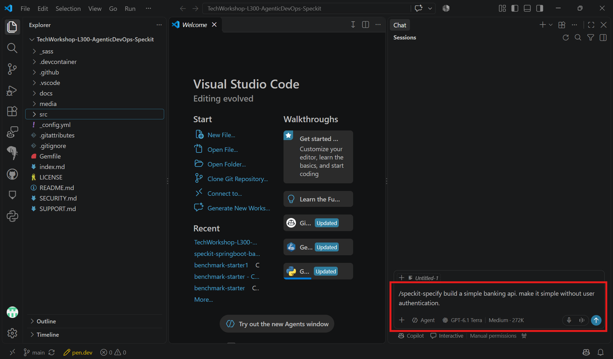
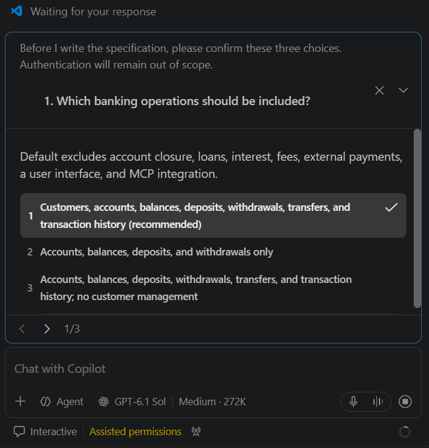

# Task 01 - Specify

> **Workshop scope:** Specify a simple local banking API without user authentication.

## Introduction

The specification captures what the banking API should do, without choosing implementation details yet.

## Description

Run `/speckit-specify` in Copilot chat with the banking prompt below, then review the generated specification before planning. Run each Spec Kit skill separately in chat, not in the terminal.

## Success Criteria

- The specification covers fictional customers, account listing, balances, simulated deposits, withdrawals, transfers, and transaction history.
- It preserves the existing CSV identifiers, relationships, THB balances, and transaction histories without duplicating imports or replaying history.
- Acceptance checks compare balances and histories for successful and insufficient-funds transfers, and cover invalid amounts, missing accounts, and transfers to the same account.
- No login, registration, tokens, roles, real financial data, or public deployment are required.

## Learning Resources

- [Spec Kit quickstart: specify](https://github.github.io/spec-kit/quickstart.html)

## Key Tasks

### 01: Choose a model

<details markdown="block">
<summary><strong>Expand this section to view the solution</strong></summary>

For early steps such as Specify and Plan, a more capable reasoning model is recommended. Open the model picker in Copilot chat and choose **GPT-6.1 Sol**, **GPT-6.1 Terra**, or **Claude Sonnet 5.5**, as available in your environment.



Alternatively, choose **Copilot Fusion**, which selects a model or combines models for the work. For this lab, set its **Effort Level** to **High**.





</details>

### 02: Set permissions

<details markdown="block">
<summary><strong>Expand this section to view the solution</strong></summary>

Normally, use **Manual permissions** to retain control over tool approvals. For this lab, choose **Assisted permissions**, which evaluates risk before running tools. Review any approval requests; do not select **Allow all** or disable existing safety controls.



</details>

### 03: Run Specify

Run the sample `/speckit-specify` prompt below in Copilot chat, not in the terminal.

<details markdown="block">
<summary><strong>Expand this section to view the solution</strong></summary>

Paste this stack-neutral prompt into Copilot chat:

```text
/speckit-specify Specify a simple fictional local banking API without user authentication, using the existing customers.csv, accounts.csv, transfers.csv, and transaction_entries.csv files under src\data\seed as the baseline. Preserve their UUIDs, THB currency, relationships, existing balances, and transaction histories. Include customers, accounts, balances, deposits, withdrawals, transfers, and history. Require repeatable import without duplicates or replaying history into imported balances. For acceptance checks, choose distinct same-currency UUID accounts with sufficient funds; compare both balances and histories before and after a successful transfer and a rejected insufficient-funds transfer. Keep the interface client-neutral and services and forwarded ports private; do not use real financial data or add login or public deployment. Ask questions for clarification and wait for my answers before writing.
```

The screenshot shows an earlier, shorter prompt; use the seed-aware prompt above.



</details>

### 04: Answer clarification questions

Answer Copilot's clarification questions by selecting the option you prefer for each question.

<details markdown="block">
<summary><strong>Expand this section to view the solution</strong></summary>

Copilot asks for clarification before writing the specification. Select the option you prefer for each question, then continue through the remaining questions and submit your answers. Keep authentication out of scope and use fictional data only.



</details>

### 05: Review the specification

Review the generated `spec.md`. The existing fictional baseline is `customers.csv`, `accounts.csv`, `transfers.csv`, and `transaction_entries.csv` under `src\data\seed` (`src/data/seed` on Unix-like systems). Preserve the UUID identifiers, relationships, THB currency, existing account balances, and transaction history when importing them. Initialization must be repeatable without duplicate records, overwriting subsequent changes, or replaying the imported history into the imported balances.

Keep the feature scope to fictional customers, account listing, balances, simulated deposits, withdrawals, transfers, and transaction history.

### 06: Add acceptance checks

Add acceptance checks for normal and invalid requests. Select two distinct, same-currency UUID accounts with sufficient funds in the source account. Compare both balances and histories before and after a successful transfer, then record a new baseline and verify that an insufficient-funds transfer changes neither balance nor history. Confirm that transfers either complete in full or make no changes.

### 07: Resolve remaining clarifications

Resolve any clarification markers before planning. Remove any generated authentication or production-deployment requirements.
