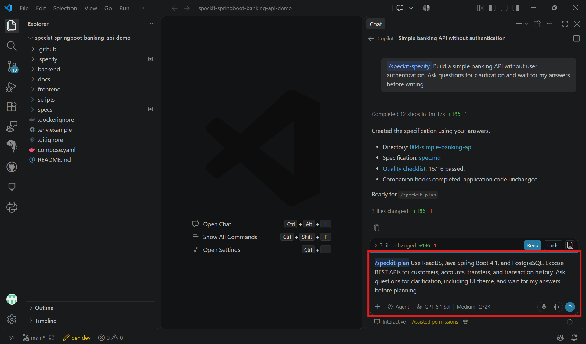
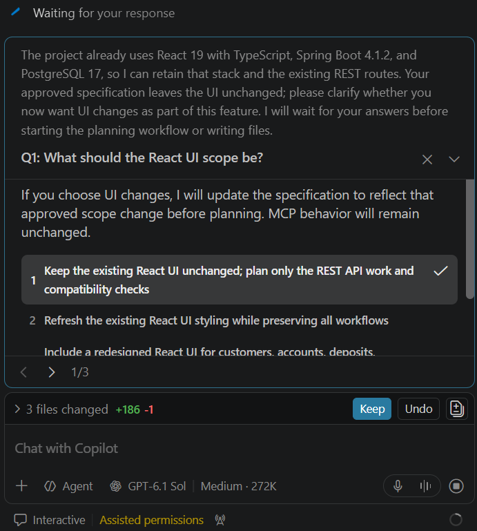

# Task 02 - Plan

> **Workshop scope:** Plan a small local banking REST API, not a production banking platform.

## Introduction

An implementation plan connects the approved banking requirements to ReactJS, local PostgreSQL, and your selected Java or .NET backend.

## Description

Run `/speckit-plan` in Copilot chat to turn the reviewed specification into a technical plan for one backend. Keep banking rules in a service used by the REST endpoints.

## Success Criteria

- The plan covers ReactJS, local PostgreSQL, fictional seed data, verification, and either Java Spring Boot 4.1 or an ASP.NET Core 10 controller-based Web API targeting `net10.0`.
- REST APIs cover customers, accounts, balances, deposits, withdrawals, transfers, and transaction history.
- OpenAPI documentation is generated and Swagger UI is configured for local development.
- The existing CSV identifiers, relationships, THB balances, and histories are preserved without duplicate imports or replaying history into imported balances.
- Money uses decimal-safe types, and transfers update both accounts and their transaction history atomically.
- The ReactJS interface uses the REST APIs without login screens.
- The plan contains no user authentication and preserves the fictional-only, local-only, non-public boundary.

## Learning Resources

- [Spec Kit quickstart: plan](https://github.github.io/spec-kit/quickstart.html)
- [ASP.NET Core OpenAPI and Swagger UI](https://learn.microsoft.com/en-us/aspnet/core/fundamentals/openapi/using-openapi-documents?view=aspnetcore-10.0)

## Key Tasks

### 01: Run Plan

Select the backend you intend to build, then run its `/speckit-plan` prompt in Copilot chat, not in the terminal. The tab changes only the displayed example; it does not change the specification or generated artifacts.

<details markdown="block">
<summary><strong>Expand this section to view the solution</strong></summary>

Copy only the prompt for your selected backend into Copilot chat:


```text
/speckit-plan Use ReactJS, JDK 21, Maven 3.9, Java Spring Boot 4.1, and local PostgreSQL. Expose REST APIs for customers, accounts, balances, deposits, withdrawals, transfers, and transaction history. Keep banking rules in a service used by the controllers. Generate OpenAPI documentation and configure Swagger UI for local development. Import the existing fictional customers.csv, accounts.csv, transfers.csv, and transaction_entries.csv from src\data\seed, preserving their UUIDs, THB currency, relationships, existing histories, and balances. Make initialization repeatable without duplicate imports, overwriting subsequent changes, or replaying historical transactions into imported balances. Use BigDecimal and PostgreSQL numeric for money and update both account balances and transaction history atomically for transfers. For verification, select distinct same-currency UUID accounts with sufficient funds; compare both balances and histories before and after a successful transfer and before and after a rejected insufficient-funds transfer. Keep the React interface client-neutral and consume the REST APIs without login screens. Use port 8080 for the local backend and keep all services and forwarded ports private. Do not add user authentication, public deployment, or MCP work in this exercise. Include build, test, startup, and REST/UI verification instructions for the generated project layout. Ask questions for clarification, including UI theme, and wait for my answers before planning.
```


ASP.NET Core OpenAPI generation does not include Swagger UI automatically; plan both explicitly.

```text
/speckit-plan Use ReactJS, an ASP.NET Core 10 controller-based Web API targeting net10.0, Entity Framework Core 10 with the Npgsql PostgreSQL provider version 10, and local PostgreSQL. Expose REST APIs for customers, accounts, balances, deposits, withdrawals, transfers, and transaction history. Keep banking rules in a service used by the controllers. Use Microsoft.AspNetCore.OpenApi 10 to generate OpenAPI documentation and configure Swashbuckle.AspNetCore.SwaggerUI separately to display it in the local Development environment. Import the existing fictional customers.csv, accounts.csv, transfers.csv, and transaction_entries.csv from src\data\seed, preserving their UUIDs, THB currency, relationships, existing histories, and balances. Make initialization repeatable without duplicate imports, overwriting subsequent changes, or replaying historical transactions into imported balances. Use C# decimal and PostgreSQL numeric for money and update both account balances and transaction history atomically for transfers. For verification, select distinct same-currency UUID accounts with sufficient funds; compare both balances and histories before and after a successful transfer and before and after a rejected insufficient-funds transfer. Keep the React interface client-neutral and consume the REST APIs without login screens. Use port 8080 for the local backend and keep all services and forwarded ports private. Do not add user authentication, public deployment, or MCP work in this exercise. Include build, test, startup, and REST/UI verification instructions for the generated project layout. Ask questions for clarification, including UI theme, and wait for my answers before planning.
```



The following screenshot illustrates an earlier **Java** planning prompt. Use the updated prompt in your selected tab instead.



</details>

### 02: Answer clarification questions

Answer Copilot's clarification questions by selecting the option you prefer for each question.

<details markdown="block">
<summary><strong>Expand this section to view the solution</strong></summary>

Copilot asks for clarification before generating the plan, including the ReactJS interface scope and theme. Select the option you prefer for each question, then continue through the remaining questions and submit your answers. Use a generic, client-neutral theme.

If your choices change the approved feature scope, ensure the specification is updated before planning. Keep authentication out of scope and use fictional data only.



</details>

### 03: Review the plan

Review the generated `plan.md` and supporting design artifacts for customer and account data models, REST contracts, the agreed ReactJS interface scope, and local configuration. Record the paths of the backend application, its tests, and the frontend that the plan proposes; the application projects do not yet exist in the starter repository.

### 04: Check banking rules and constraints

Check input validation, atomic transfers, decimal-safe money handling, repeatable import of all four existing CSVs, and the absence of authentication requirements. Verify that the plan compares the imported balances and histories before and after both successful and rejected operations.

### 05: Approve the plan

Approve the plan before moving to Tasks. Keep the application and database private to the local machine.

**Review gate:** The approved plan maps back to the specification, preserves its non-goals, and is small enough to implement during the workshop.
