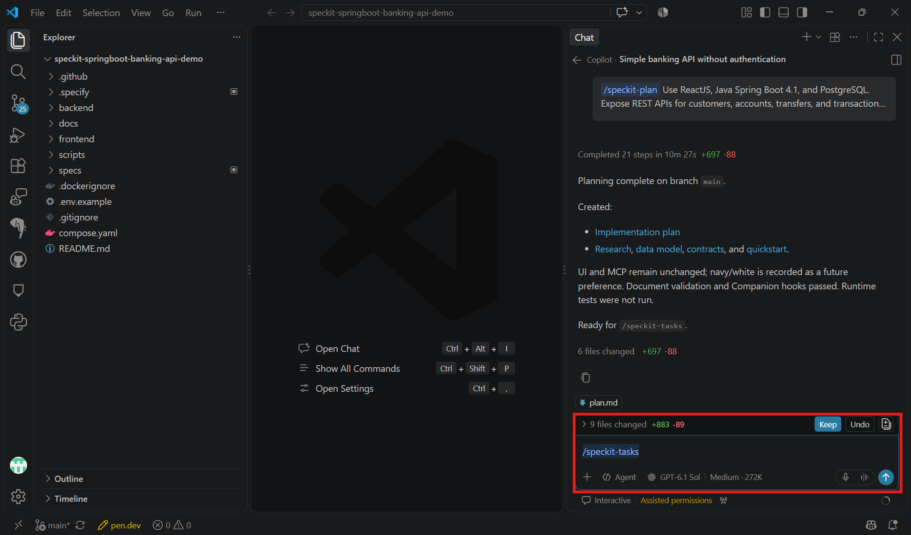

# Task 03 - Tasks

> **Workshop scope:** Break the approved banking API plan into small, executable tasks.

## Introduction

A task list turns the specification and technical plan into dependency-ordered implementation work.

## Description

Run `/speckit-tasks` in Copilot chat to generate `tasks.md` from the approved design artifacts. Review the task list before allowing implementation to begin.

## Success Criteria

- Tasks cover the database, fictional seed data, banking service, REST endpoints, ReactJS interface, and tests.
- Dependencies are clear and each task identifies the files or components to change.
- The task list preserves the local-only scope without adding authentication.

## Learning Resources

- [Spec Kit quickstart: tasks](https://github.github.io/spec-kit/quickstart.html)

## Key Tasks

### 01: Run Tasks

Run `/speckit-tasks` in Copilot chat, not in the terminal.

<details markdown="block">
<summary><strong>Expand this section to view the solution</strong></summary>

```text
/speckit-tasks
```



</details>

### 02: Review the task list

Review the generated `tasks.md` against `spec.md` and `plan.md`.

<details markdown="block">
<summary><strong>Expand this section to view the solution</strong></summary>

Start with the tasks for your selected backend:


- Create the Java Spring Boot 4.1 backend with JDK 21 and Maven 3.9.
- Configure PostgreSQL, OpenAPI generation, and Swagger UI; use `BigDecimal` for money.


- Create an ASP.NET Core 10 controller-based Web API targeting `net10.0`.
- Configure EF Core 10 with the Npgsql PostgreSQL provider version 10 and use `decimal` for money.
- Configure OpenAPI document generation and add `Swashbuckle.AspNetCore.SwaggerUI` separately for local development.



Then review the common task order:

1. Configure local PostgreSQL, create the customer, account, transfer, and transaction-entry tables, and import the four existing fictional CSVs. Preserve UUID relationships, THB balances, and history; make reinitialization safe without duplicates or replaying history.
2. Implement the banking service with amount validation, decimal-safe arithmetic, and transactional balance and history updates.
3. Add REST endpoints for customers, accounts, balances, deposits, withdrawals, transfers, and transaction history using the banking service.
4. Build a client-neutral ReactJS interface that consumes the customer, account, transfer, and transaction-history APIs.
5. Add and run service, REST, and frontend tests for valid operations, rejected requests, and transfer rollback, comparing both balances and histories.
6. Document local startup and verification for the generated project paths without user credentials or public access.

</details>

### 03: Check verification coverage

Check that validation, atomic transfers, transaction history, and acceptance tests are included.

### 04: Approve the task list

Confirm dependencies and remove out-of-scope work before moving to Implement.

**Review gate:** Every required banking behavior has an implementation task and an appropriate verification task, including the ReactJS interface.
