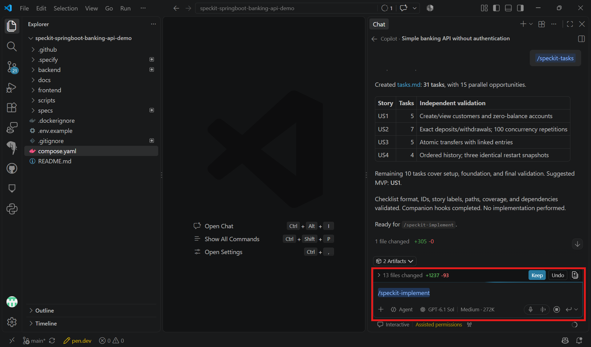

# Task 04 - Implement

> **Workshop scope:** Implement the approved local banking API without user authentication.

## Introduction

Implementation follows the reviewed task list rather than introducing new requirements.

## Description

Run `/speckit-implement` in Copilot chat to execute `tasks.md` in dependency order and build the banking API and ReactJS interface.

## Success Criteria

- The banking REST endpoints are implemented against the banking service.
- The ReactJS interface consumes the customer, account, transfer, and transaction-history APIs.
- Required tests pass and task completion reflects the actual work.
- The application uses fictional data, needs no user credentials, and remains local-only.

## Learning Resources

- [Spec Kit quickstart: implement](https://github.github.io/spec-kit/quickstart.html)

## Key Tasks

### 01: Run Implement

Run `/speckit-implement` in Copilot chat after approving `tasks.md`, not in the terminal.

<details markdown="block">
<summary><strong>Expand this section to view the solution</strong></summary>

```text
/speckit-implement
```



</details>

### 02: Resolve incomplete checklists

If implementation reports incomplete requirements checklists, review and resolve them before proceeding.

### 03: Review changes and run tests

Review generated changes and run the planned service, REST, and frontend tests.

Start private local PostgreSQL and apply the planned migrations and repeatable CSV import using the instructions generated for your project. Do not reset or overwrite existing data. The starter repository does not contain a finished backend: locate the **actual generated** application and test directories, compare them with `plan.md`, and update the plan if the layout changed.

Use the commands for your selected backend only:


In a terminal, open the generated Maven root or backend module containing its `pom.xml`. Build and run its configured tests:

```bash
mvn verify
```

Run the relevant tests in any additional generated modules not covered by that build. Confirm that the expected tests actually ran.

To start the application, switch to the generated Spring Boot application module if it differs from the Maven root:

```bash
mvn spring-boot:run "-Dspring-boot.run.arguments=--server.port=8080 --server.address=127.0.0.1"
```


In a terminal, open the generated backend solution directory containing its `.sln` or `.slnx`, or the generated API project directory containing its `.csproj` if there is no solution. Restore and build:

```bash
dotnet restore
dotnet build --no-restore
```

Run tests from the generated solution directory if it includes the test projects; otherwise switch to each generated test-project directory and run:

```bash
dotnet test
```

If a directory contains multiple solution or project files, supply the actual generated filename to the command. Confirm that the expected tests actually ran.

To start the API, switch to the generated Web API `.csproj` directory and run:

```bash
dotnet run --no-launch-profile -- --environment Development --urls http://localhost:8080
```

This requests the Development environment and port **8080** on loopback. Because launch profiles are skipped, configure any required local database connection separately as described in your plan. Check the startup output and generated Kestrel configuration if a different endpoint is reported.



Use the actual generated frontend directory and its documented package-manager commands to install dependencies, run frontend tests, and start React. Configure it to call the selected backend on port 8080. Check the generated OpenAPI document and Swagger UI URLs as well; their paths depend on your implementation. Keep the application, database, and any forwarded ports private.

### 04: Verify the local application

Start the local application and verify customer and account views, simulated transfers, and transaction history through REST and the ReactJS interface before moving to Converge.

<details markdown="block">
<summary><strong>Expand this section to view the solution</strong></summary>

**Verification:**

1. Confirm the application imported the existing fictional `customers.csv`, `accounts.csv`, `transfers.csv`, and `transaction_entries.csv` from `src\data\seed` (`src/data/seed` on Unix-like systems), preserving UUID relationships, THB currency, existing balances, and histories.
2. Select two distinct account UUIDs in the same currency. Choose a positive transfer amount that the source account can cover. Record both current balances and both relevant histories before the operation.
3. Make the simulated transfer through REST. Compare the results with the recorded baseline: the source is debited by the amount, the destination is credited by the same amount, and matching debit and credit history entries are added without losing earlier history. Check the same results in React.
4. Record both balances and histories again. Attempt a transfer for more than the source's now-available balance. Confirm a clear insufficient-funds error and **no change** to either balance or history.
5. Repeat initialization using the generated procedure without resetting data. Confirm there are no duplicate imports, no replay of historical transactions into balances, and no loss or reversal of the changes just made.

Also check invalid amounts, missing accounts, and a transfer to the same account. Verify that rollback tests cover a failure during a transfer, not only validation failures.

</details>

**Review gate:** The planned tests pass, local REST calls work without user credentials, and completed tasks are marked in `tasks.md`.
