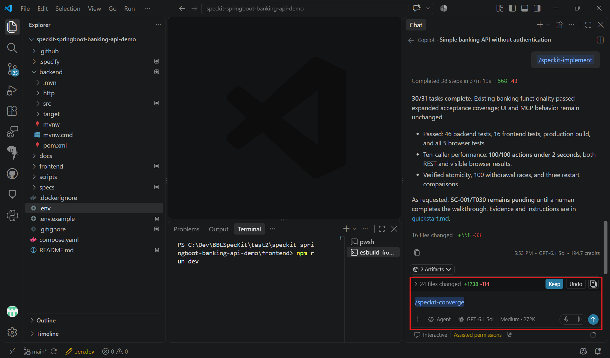

# Task 05 - Converge

> **Workshop scope:** Verify the implementation against the banking specification, plan, and tasks.

## Introduction

Completing the task list does not by itself prove that the implementation satisfies the specification.

## Description

Run `/speckit-converge` in Copilot chat to check the codebase against `spec.md`, `plan.md`, and `tasks.md`. If it finds gaps, it appends new tasks to `tasks.md`. Implement those tasks and repeat convergence until it reports **Converged**.

Converge the selected backend and the shared React/PostgreSQL implementation against their approved artifacts. You do not need to generate or run the other backend.

## Success Criteria

- Convergence reports no remaining gaps against the approved artifacts.
- Any added tasks are implemented and the relevant tests pass.
- Banking API behavior still matches the fictional, unauthenticated, local-only scope.

## Learning Resources

- [Spec Kit quickstart: converge](https://github.github.io/spec-kit/quickstart.html)

## Key Tasks

### 01: Run Converge

Run `/speckit-converge` in Copilot chat after implementation and review its findings.

<details markdown="block">
<summary><strong>Expand this section to view the solution</strong></summary>

```text
/speckit-converge
```



</details>

### 02: Address reported gaps

If gaps are found, review the appended tasks and run `/speckit-implement` to address them.

<details markdown="block">
<summary><strong>Expand this section to view the solution</strong></summary>

Run the implementation skill separately and review its result:

```text
/speckit-implement
```

**Example gap:** Withdrawals allow an account to be overdrawn. Review the new task, add the missing validation and a regression test, and verify that rejected withdrawals leave balances and history unchanged before converging again.

</details>

### 03: Rerun tests and convergence

Rerun the affected tests and `/speckit-converge` until it reports **Converged**.

<details markdown="block">
<summary><strong>Expand this section to view the solution</strong></summary>

After the affected tests pass, run convergence again in Copilot chat:

```text
/speckit-converge
```

</details>

### 04: Review completion

Review the final changes and confirm the original banking acceptance checks, including before/after balances and histories for successful and insufficient-funds transfers.

**Completion gate:** Convergence reports **Converged**, the required tests pass, and the original acceptance checks remain satisfied without adding authentication or public deployment.
