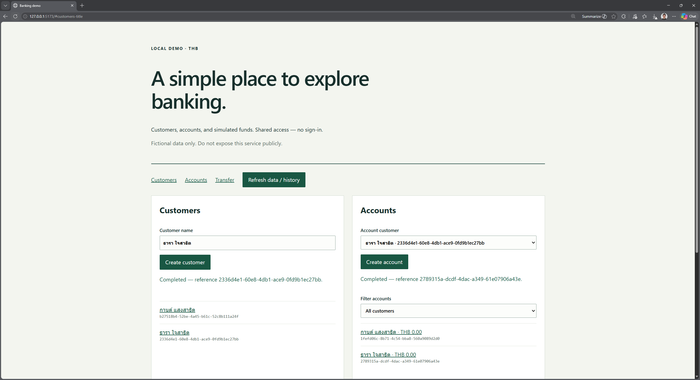
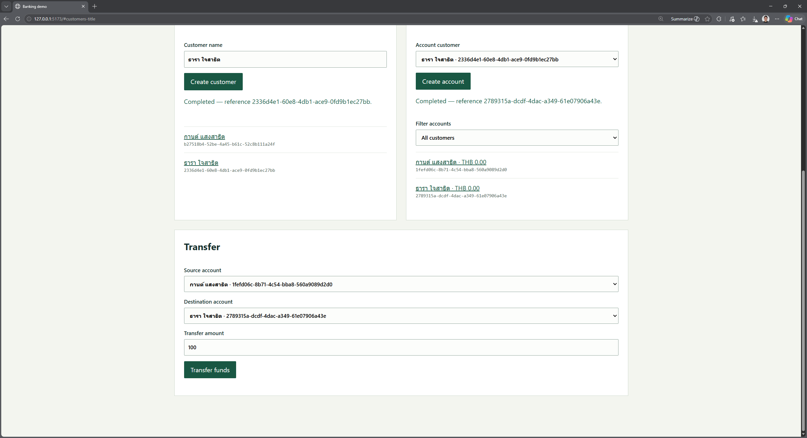

# Task 06 - Example result

> **Example only:** Your result may look different depending on your model, clarification answers, and UI theme, but it should provide similar banking features that match your approved specification.

## Introduction

These screenshots show one possible result of the Specify, Plan, Tasks, Implement, and Converge workflow.

## Description

Compare your local application with the example. Layout, labels, currency, and fictional sample data may differ; focus on the agreed banking behavior rather than reproducing the screenshots exactly.

## Success Criteria

- The application provides the customer, account, transfer, and transaction-history features in the approved specification.
- The ReactJS interface and REST API show consistent balances and transaction history.
- All data is fictional, no user authentication is required, and the application remains local-only.

## Learning Resources

- [Plan the implementation](04_02.md)
- [Verify convergence](04_05.md)

## Key Tasks

### 01: Compare customer and account features

Review the customer and account views in your application.

<strong>Expand this section to view the solution</strong>

This example shows customer creation and listing, account creation, and account balances. Your interface may use a different layout or theme while providing similar features within your approved scope.

### 02: Compare the transfer feature

Review how your application selects source and destination accounts and accepts a transfer amount.

<strong>Expand this section to view the solution</strong>

This example provides source-account and destination-account selectors, an amount field, and a transfer action. Verify a successful simulated transfer and check the resulting balances and transaction history in your own application.

### 03: Verify behavior against your specification

Run your acceptance checks for valid operations, invalid amounts, insufficient funds, and transaction history. Different visuals are acceptable; missing or incorrect required behavior should be addressed through the convergence workflow.
