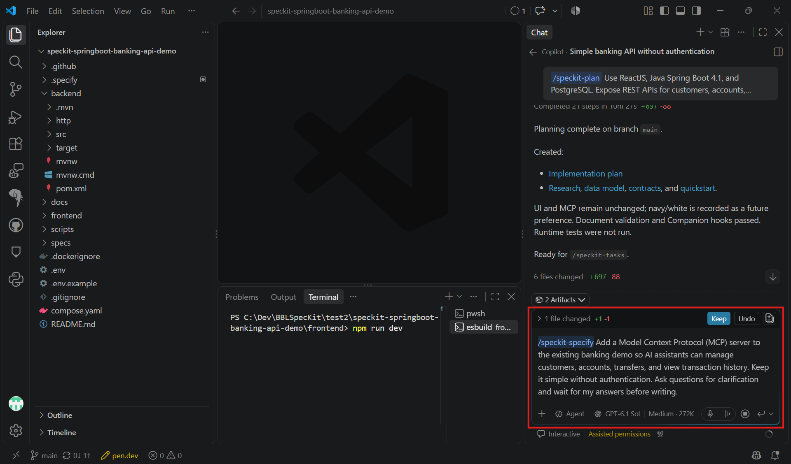
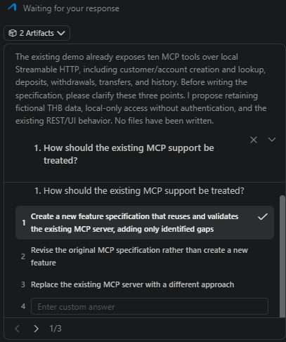

# Task 01 - Specify

> **Workshop scope:** Specify MCP access to the existing fictional banking demo without authentication.

## Introduction

The banking demo already provides REST APIs and persistent data. This feature adds an MCP interface so AI assistants can use the same banking capabilities.

## Description

Run `/speckit-specify` in Copilot chat to define the MCP feature. Clarify the intended capabilities before generating the specification, without rebuilding the banking application.

## Success Criteria

- The specification covers customers, accounts, simulated transfers, and transaction history through MCP.
- Allowed read and write operations and their validation rules are explicit.
- Existing REST behavior is preserved, and all data remains fictional and local-only.
- No login, tokens, roles, or real banking connections are added.

## Learning Resources

- [Spec Kit quickstart: specify](https://github.github.io/spec-kit/quickstart.html)
- [Model Context Protocol documentation](https://modelcontextprotocol.io/docs/getting-started/intro)

## Key Tasks

### 01: Run Specify

Run the prompt below in Copilot chat, not in the terminal.

<details markdown="block">
<summary><strong>Expand this section to view the solution</strong></summary>

```text
/speckit-specify Add a Model Context Protocol (MCP) server to the existing banking demo so AI assistants can manage customers, accounts, transfers, and view transaction history. Keep it simple without authentication. Ask questions for clarification and wait for my answers before writing.
```



</details>

### 02: Answer clarification questions

Select the option you prefer for each question and submit your answers before Copilot writes the specification.

<details markdown="block">
<summary><strong>Expand this section to view the solution</strong></summary>

Clarify which customer and account actions are needed, whether simulated transfers are allowed, and what transaction history should return. Keep the scope small and exclude unrelated features such as real payments or changes to the frontend.

For example, you might allow customer and account listing, customer and account creation, balance checks, simulated transfers, and transaction-history queries. The final set must match your approved choices.



</details>

### 03: Review the specification

Review the generated `spec.md`. Confirm that MCP uses the existing banking data and rules and does not replace or change the REST APIs.

### 04: Add acceptance checks

Include tool discovery, valid reads, approved writes, missing records, invalid amounts, insufficient funds, and rejected operations leaving data unchanged. A successful MCP transfer must appear in REST balances and transaction history.

### 05: Resolve remaining clarifications

Resolve clarification markers before planning. Preserve the unauthenticated, fictional-only, local-only boundary.
