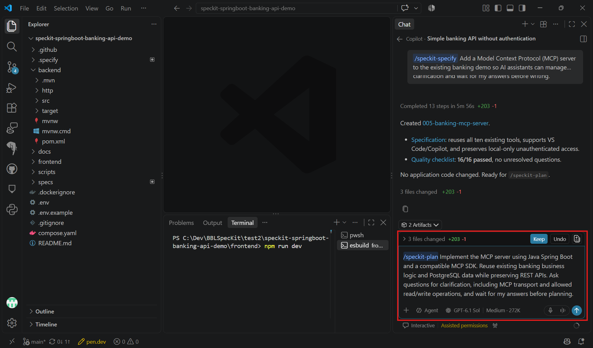
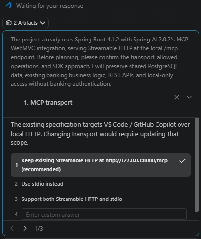

# Task 02 - Plan

> **Workshop scope:** Plan a compatible MCP integration that reuses the existing backend and PostgreSQL data.

## Introduction

The implementation plan connects the MCP requirements to the existing Java Spring Boot application without introducing a second banking implementation.

## Description

Run `/speckit-plan` in Copilot chat. Select a compatible MCP SDK, clarify the transport and permitted operations, and map each tool to the existing banking service.

## Success Criteria

- The selected MCP SDK supports the existing Spring Boot version and chosen transport.
- Tools reuse banking services, validation, transactions, and PostgreSQL data.
- The plan preserves REST contracts and existing frontend behavior.
- The transport is local-only, and no authentication or public deployment is added.

## Learning Resources

- [Spec Kit quickstart: plan](https://github.github.io/spec-kit/quickstart.html)
- [Spring AI MCP overview](https://docs.spring.io/spring-ai/reference/api/mcp/mcp-overview.html)
- [MCP Java SDK](https://github.com/modelcontextprotocol/java-sdk)

## Key Tasks

### 01: Run Plan

Run the prompt below in Copilot chat, not in the terminal.

<details markdown="block">
<summary><strong>Expand this section to view the solution</strong></summary>

```text
/speckit-plan Implement the MCP server using Java Spring Boot and a compatible MCP SDK. Reuse existing banking business logic and PostgreSQL data while preserving REST APIs. Include a test.http file for VS Code REST Client with runnable MCP initialization, tool listing, and banking tool calls, including required headers, session handling where applicable, sample data, and expected results. Ask questions for clarification, including MCP transport and allowed read/write operations, and wait for my answers before planning.
```



</details>

### 02: Answer clarification questions

Select the option you prefer for the MCP transport and allowed read/write operations.

<details markdown="block">
<summary><strong>Expand this section to view the solution</strong></summary>

Choose a transport supported by both the selected SDK and your intended MCP client, such as stdio or Streamable HTTP. For an HTTP transport, bind the listener to loopback only and keep forwarded ports private. For stdio, document how the client starts the server process.

Confirm the exact read and write tools to expose. If these choices change the approved feature scope, update the specification before planning.



</details>

### 03: Review the plan

Review `plan.md` and supporting design artifacts for SDK compatibility, transport configuration, tool names, input/output schemas, error handling, and service mappings.

### 04: Check banking rules and regression coverage

Ensure that money remains decimal-safe, transfers remain atomic, and MCP writes use the same validation as REST. Plan tests for tool discovery, invocation, rejected operations, and unchanged REST behavior.

### 05: Approve the plan

Approve the plan before moving to Tasks. Do not introduce a separate database, duplicate seed loading, or frontend changes.

**Review gate:** The plan maps the approved MCP capabilities to existing banking services and preserves the local-only application boundary.
