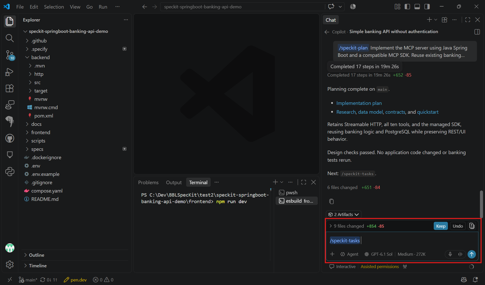

# Task 03 - Tasks

> **Workshop scope:** Break the approved MCP plan into small, dependency-ordered tasks.

## Introduction

The task list turns the MCP specification and technical plan into executable work without rebuilding the banking demo.

## Description

Run `/speckit-tasks` in Copilot chat to generate `tasks.md`, then review the tasks against the approved MCP scope.

## Success Criteria

- Tasks cover SDK setup, transport configuration, approved tools, and verification.
- Each tool maps to existing banking services rather than duplicating business logic.
- REST regression checks and local startup instructions are included.

## Learning Resources

- [Spec Kit quickstart: tasks](https://github.github.io/spec-kit/quickstart.html)

## Key Tasks

### 01: Run Tasks

Run `/speckit-tasks` in Copilot chat, not in the terminal.

<details markdown="block">
<summary><strong>Expand this section to view the solution</strong></summary>

```text
/speckit-tasks
```



</details>

### 02: Review the task list

Review the generated `tasks.md` against `spec.md` and `plan.md`.

<details markdown="block">
<summary><strong>Expand this section to view the solution</strong></summary>

**Expected task order:**

1. Add compatible MCP dependencies and configure the chosen local transport.
2. Register approved read tools for customers, accounts, balances, and transaction history.
3. Implement only the approved write tools, such as customer creation, account creation, and simulated transfers, using existing banking services.
4. Add protocol-level discovery and invocation tests, banking validation checks, and REST regression tests.
5. Document startup, client connection settings, and example fictional inputs for the selected transport.

</details>

### 03: Check verification coverage

Confirm that the tasks cover shared data visibility, invalid inputs, missing records, insufficient funds, atomic transfers, and the absence of unapproved write tools.

### 04: Approve the task list

Confirm dependencies and remove out-of-scope work before moving to Implement.

**Review gate:** Every approved MCP capability has an implementation task and a verification task, with existing REST behavior protected.
