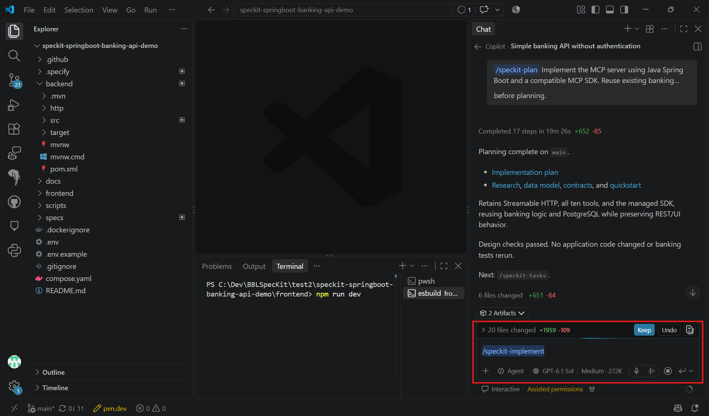

# Task 04 - Implement

> **Workshop scope:** Implement the approved MCP tools using the existing banking application without authentication.

## Introduction

MCP is an additional interface to the banking demo, not a replacement for its REST APIs or service layer.

## Description

Run `/speckit-implement` in Copilot chat to execute the approved tasks. Review dependency and configuration changes, then verify the tools over the selected MCP transport.

## Success Criteria

- An MCP client can discover and invoke the approved tools locally.
- Reads and approved writes use the existing banking services and PostgreSQL data.
- Required tests pass and existing REST APIs and frontend behavior remain intact.
- No authentication, real financial data, or public exposure is introduced.

## Learning Resources

- [Spec Kit quickstart: implement](https://github.github.io/spec-kit/quickstart.html)
- [Model Context Protocol documentation](https://modelcontextprotocol.io/docs/getting-started/intro)

## Key Tasks

### 01: Run Implement

Run `/speckit-implement` in Copilot chat after approving `tasks.md`, not in the terminal.

<details markdown="block">
<summary><strong>Expand this section to view the solution</strong></summary>

```text
/speckit-implement
```



</details>

### 02: Resolve incomplete checklists

If implementation reports incomplete requirements checklists, review and resolve them before proceeding.

### 03: Review changes and run tests

Review the generated MCP tool schemas, service calls, and transport settings. Run the planned MCP, banking-service, and REST regression tests.

### 04: Verify the local MCP server

Start the application using the generated startup instructions. Use an MCP client or protocol test harness to discover tools and invoke the approved operations.

<details markdown="block">
<summary><strong>Expand this section to view the solution</strong></summary>

**Read check:** List fictional accounts through MCP and compare their balances and transaction history with the REST API.

**Approved write check:** If transfers are enabled, record two fictional account balances, then transfer a valid amount through MCP. Verify that REST shows the corresponding balance changes and both transaction entries.

**Invalid request check:** Attempt an invalid amount or an overdrawing transfer. Confirm a clear tool error and no balance or history changes.

**Regression check:** Repeat the existing REST acceptance checks and confirm that the ReactJS interface still works.

</details>

**Review gate:** Approved MCP calls work locally without user credentials, planned tests pass, and completed tasks reflect the actual work.
