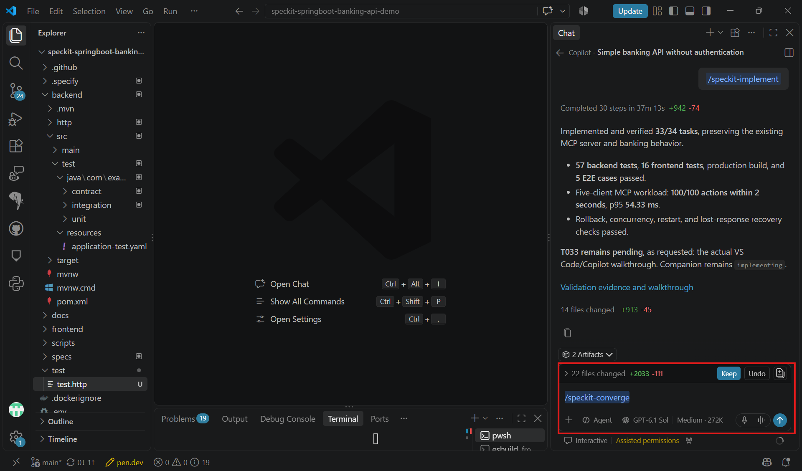

# Task 05 - Converge

> **Workshop scope:** Verify MCP completeness and preserve existing banking behavior.

## Introduction

The MCP feature is complete only when the implementation matches the approved specification, plan, and tasks.

## Description

Run `/speckit-converge` in Copilot chat to check the MCP implementation against the feature artifacts. If it appends gap-fixing tasks to `tasks.md`, implement them and repeat convergence.

## Success Criteria

- Convergence reports no remaining gaps against the MCP artifacts.
- Approved tools work over the chosen transport, and unapproved operations are not exposed.
- MCP and REST share consistent data and banking rules, with regression tests passing.
- The demo remains fictional, unauthenticated, and local-only.

## Learning Resources

- [Spec Kit quickstart: converge](https://github.github.io/spec-kit/quickstart.html)

## Key Tasks

### 01: Run Converge

Run `/speckit-converge` in Copilot chat after implementation and review its findings.

<details markdown="block">
<summary><strong>Expand this section to view the solution</strong></summary>

```text
/speckit-converge
```



</details>

### 02: Address reported gaps

Review any appended tasks and run `/speckit-implement` to address them.

<details markdown="block">
<summary><strong>Expand this section to view the solution</strong></summary>

```text
/speckit-implement
```

**Example gap:** A transfer tool changes balances but bypasses transaction-history recording. Route it through the existing transfer service, add a regression test, and verify that both MCP and REST show the same result.

</details>

### 03: Rerun tests and convergence

Rerun the affected tests, including REST regressions, and converge again until it reports **Converged**.

<details markdown="block">
<summary><strong>Expand this section to view the solution</strong></summary>

```text
/speckit-converge
```

</details>

### 04: Review completion

Confirm discovery and invocation of the approved tools, clear errors for invalid requests, and unchanged REST and frontend behavior.

**Completion gate:** Convergence reports **Converged**, required tests pass, and the original local-only banking constraints remain satisfied.
