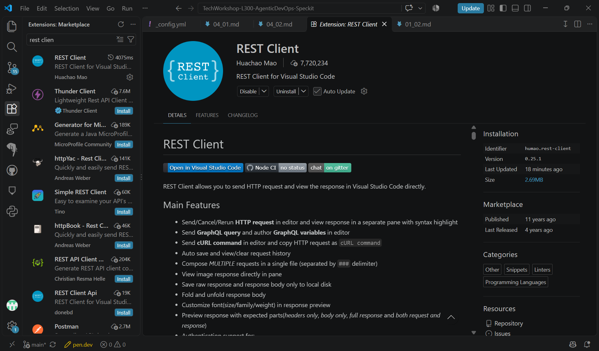
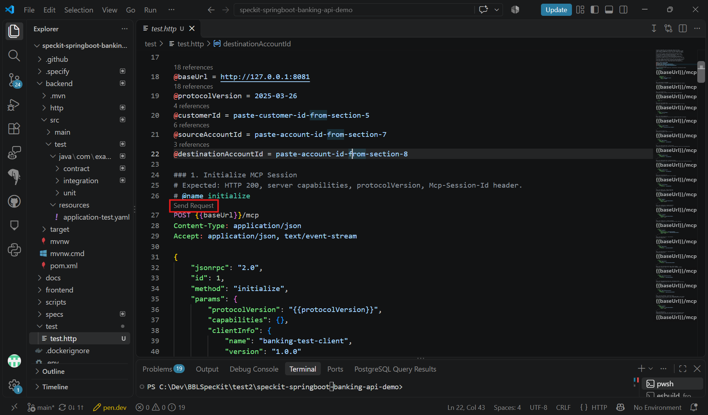
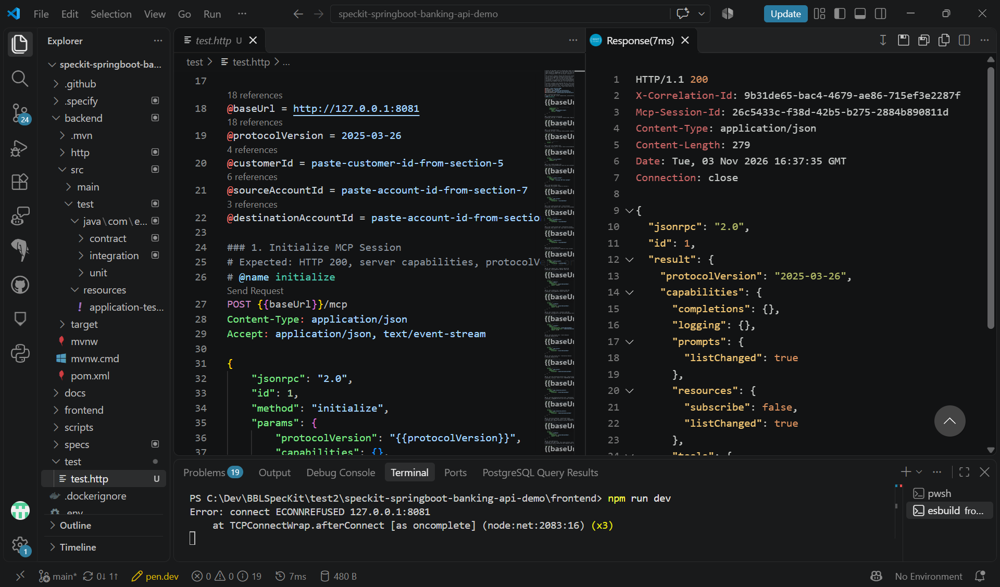
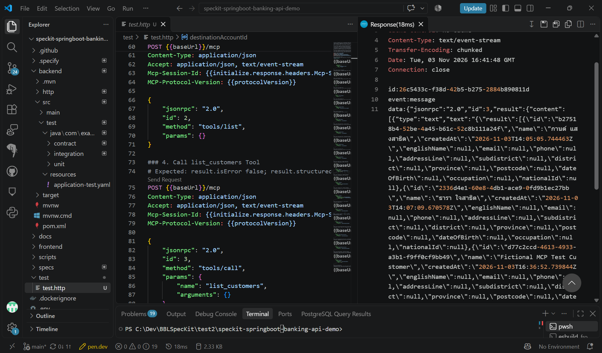

# Task 06 - Test with HTTP file

> **Workshop scope:** Test the local banking MCP server using fictional data only. This task requires Streamable HTTP; a stdio-only server must be tested with a compatible MCP client instead.

## Introduction

Use an `.http` file and the REST Client extension in VS Code to check MCP initialization, tool discovery, and tool invocation. This works locally or inside a GitHub Codespace with private ports.

## Description

Open the generated `test\test.http` file in your banking demo project and use REST Client to run its requests. The examples below explain the workflow; adapt the file location, endpoint, protocol version, tool names, and argument schemas to your implementation.

## Success Criteria

- The MCP session initializes successfully and receives an initialized notification.
- `tools/list` returns the approved banking tools and their input schemas.
- `tools/call` returns fictional banking data consistent with the REST API.
- Invalid operations return clear errors without changing balances or transaction history.

## Learning Resources

- [REST Client extension for VS Code](https://marketplace.visualstudio.com/items?itemName=humao.rest-client)
- [MCP Streamable HTTP transport](https://modelcontextprotocol.io/specification/2025-03-26/basic/transports#streamable-http)
- [MCP connection lifecycle](https://modelcontextprotocol.io/specification/2025-03-26/basic/lifecycle)

## Key Tasks

### 01: Install the REST Client extension

Install the extension used to send requests directly from `.http` files.

<details markdown="block">
<summary><strong>Expand this section to view the solution</strong></summary>

1. Open the **Extensions** view in VS Code with **Ctrl+Shift+X**.
2. Search for **REST Client**.
3. Install the extension by **Huachao Mao**, identifier `humao.rest-client`.

The extension may already be installed in your GitHub Codespace.



</details>

### 02: Open the test file

Start the MCP server using the instructions from [Implement](05_04.md), then open the generated `test\test.http` file in your banking demo project.

<details markdown="block">
<summary><strong>Expand this section to view the solution</strong></summary>

Check the variables at the top of the file. The example server shown in the screenshots uses port `8081`:

```text
@baseUrl = http://127.0.0.1:8081
@protocolVersion = 2025-03-26
```

Replace the example base URL with your actual local server address. The requests below use `/mcp`; adjust that path if your Streamable HTTP endpoint differs. Set the protocol version to a revision supported by your selected SDK; the value above is an example, not a required SDK version.

Requests are separated by `###`; click **Send Request** above a request to execute it. Run them in order and keep the server bound to loopback with any forwarded ports private. If your generated test file is missing, create `test\test.http` and add the variables and requests below.



</details>

### 03: Initialize the MCP session

Initialize the connection before listing or calling tools.

<details markdown="block">
<summary><strong>Expand this section to view the solution</strong></summary>

Send this request:

```text
### Initialize MCP session
# @name initialize
POST {{baseUrl}}/mcp
Content-Type: application/json
Accept: application/json, text/event-stream

{
  "jsonrpc": "2.0",
  "id": 1,
  "method": "initialize",
  "params": {
    "protocolVersion": "{{protocolVersion}}",
    "capabilities": {},
    "clientInfo": {
      "name": "banking-http-test",
      "version": "1.0.0"
    }
  }
}
```

Check the response for server capabilities and the negotiated protocol version. If the returned version differs, confirm that you can use it and update `@protocolVersion` before continuing.

The example response shows **HTTP 200**, server capabilities, and an `Mcp-Session-Id` header. Your response values may differ.



The `# @name initialize` line lets REST Client reuse the response headers. If the server returns `Mcp-Session-Id`, include it in **every subsequent request**, as shown below. If your server does not assign a session, remove the `Mcp-Session-Id` lines from those requests. A session identifier is not user authentication.

Complete initialization by sending:

```text
### Notify that the client is initialized
POST {{baseUrl}}/mcp
Content-Type: application/json
Accept: application/json, text/event-stream
Mcp-Session-Id: {{initialize.response.headers.Mcp-Session-Id}}
MCP-Protocol-Version: {{protocolVersion}}

{
  "jsonrpc": "2.0",
  "method": "notifications/initialized"
}
```

An accepted notification returns **202 Accepted** with no response body. Other requests may return JSON directly or inside server-sent events.

</details>

### 04: List available tools

Discover the approved banking tools and inspect their input schemas.

<details markdown="block">
<summary><strong>Expand this section to view the solution</strong></summary>

```text
### List available tools
POST {{baseUrl}}/mcp
Content-Type: application/json
Accept: application/json, text/event-stream
Mcp-Session-Id: {{initialize.response.headers.Mcp-Session-Id}}
MCP-Protocol-Version: {{protocolVersion}}

{
  "jsonrpc": "2.0",
  "id": 2,
  "method": "tools/list",
  "params": {}
}
```

The response should include the tools selected in your specification. Examples might include `list_customers`, `list_accounts`, `get_balance`, `get_transactions`, and approved write tools. Follow `nextCursor` with another `tools/list` request if the results are paginated.

Use the returned names and `inputSchema` to adapt the following examples. Do not assume that your generated tool names or argument names match exactly.

</details>

### 05: Call the banking tools

Start with read-only calls using fictional records from your application.

<details markdown="block">
<summary><strong>Expand this section to view the solution</strong></summary>

**List customers:** Click **Send Request** above the `list_customers` call in your generated file. Adjust the tool name and any required arguments to match discovery.

```text
### Call the customer-listing tool
POST {{baseUrl}}/mcp
Content-Type: application/json
Accept: application/json, text/event-stream
Mcp-Session-Id: {{initialize.response.headers.Mcp-Session-Id}}
MCP-Protocol-Version: {{protocolVersion}}

{
  "jsonrpc": "2.0",
  "id": 3,
  "method": "tools/call",
  "params": {
    "name": "list_customers",
    "arguments": {}
  }
}
```

The response should contain fictional customer records. In this example, the server returns `text/event-stream`, with the JSON-RPC result inside a `data:` event.



**Read transaction history:** Use the account-listing request in your generated file to obtain an actual fictional account identifier. Replace `ACC-001` below with that identifier, and adapt `accountId` to the discovered schema.

```text
### Call the transaction-history tool
POST {{baseUrl}}/mcp
Content-Type: application/json
Accept: application/json, text/event-stream
Mcp-Session-Id: {{initialize.response.headers.Mcp-Session-Id}}
MCP-Protocol-Version: {{protocolVersion}}

{
  "jsonrpc": "2.0",
  "id": 4,
  "method": "tools/call",
  "params": {
    "name": "get_transactions",
    "arguments": {
      "accountId": "ACC-001"
    }
  }
}
```

Compare the returned records with the same accounts and history through REST. If a call fails, inspect both JSON-RPC errors and tool results with `isError: true`; an HTTP success status alone does not prove that the tool succeeded.

</details>

### 06: Verify approved writes and errors

If write tools are enabled, confirm the intended fictional records and amount before testing a simulated transfer. Verify that both account balances and transaction histories update together and are visible through REST.

Test a missing account, an invalid amount, and insufficient funds. Confirm a clear error with no data changes. Only test operations allowed by your approved specification.
