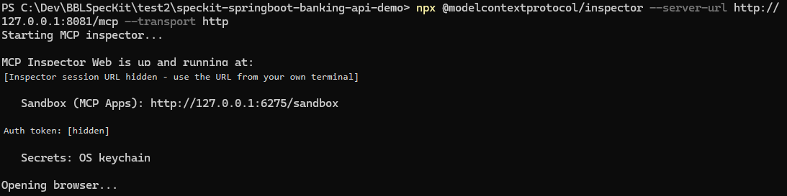
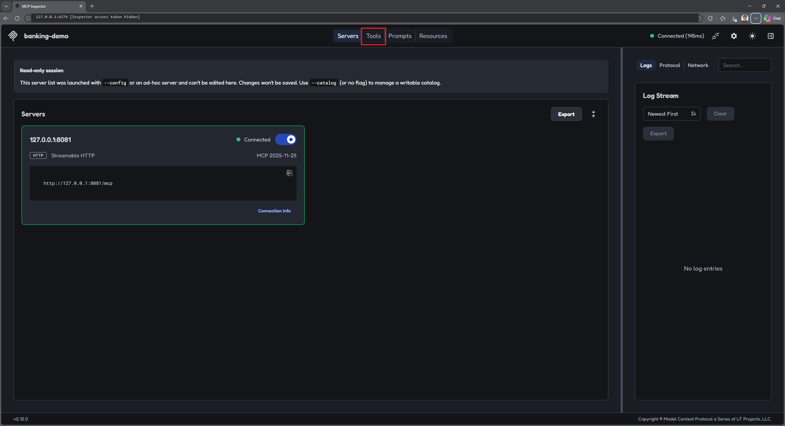
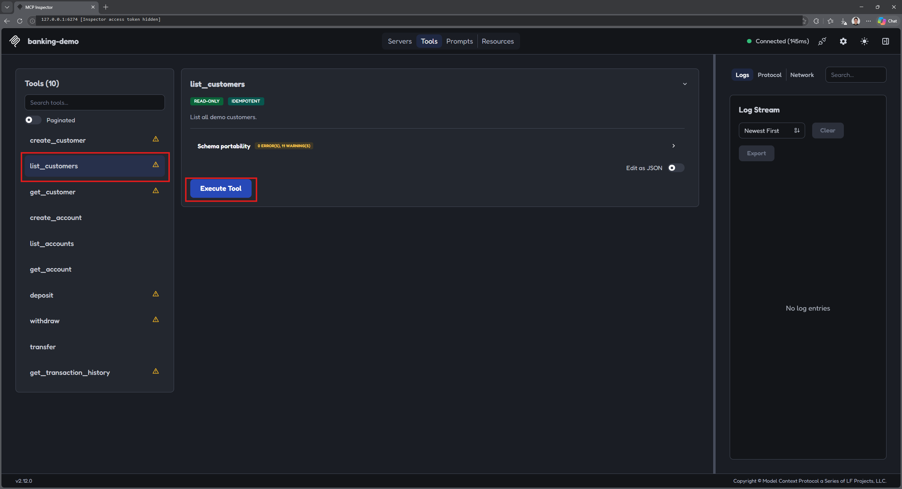
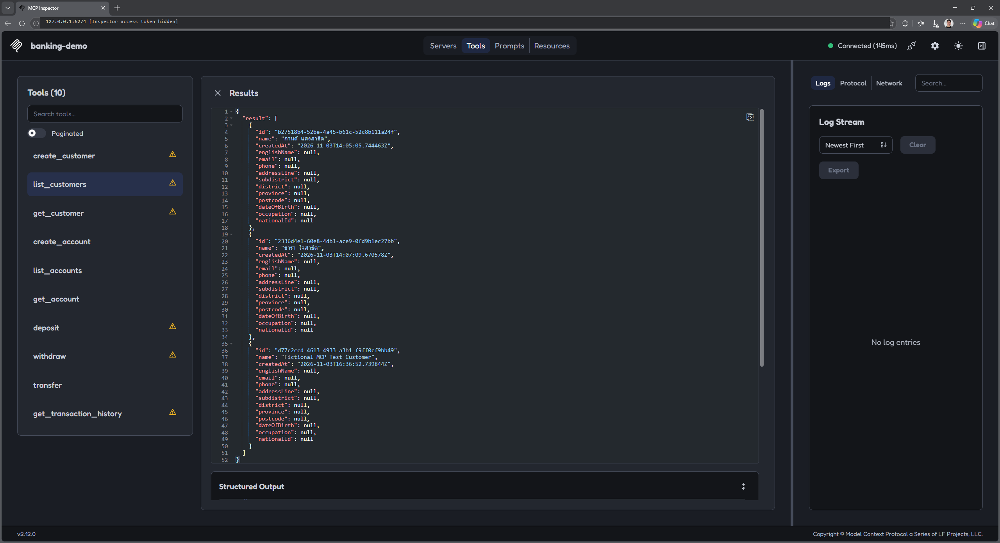

# Task 01 - Test with MCP Inspector

> **Workshop scope:** Use MCP Inspector locally to test the banking server's read-only `list_customers` tool.

## Introduction

MCP Inspector is a browser-based tool for interactively testing and debugging MCP servers. Use it to connect to the banking demo and inspect the tools created in Exercise 05.

## Description

Launch Inspector with your local Streamable HTTP endpoint, open the Tools section, and execute `list_customers`. This walkthrough uses the example endpoint `http://127.0.0.1:8081/mcp`; change the address if your server uses a different local port or path.

## Success Criteria

- MCP Inspector is running and connected to the local banking MCP server.
- The Tools section lists the banking capabilities from your implementation.
- Executing `list_customers` returns fictional customer records without changing data.
- The banking server remains local-only, and Inspector's access token is kept private.

## Learning Resources

- [MCP Inspector](https://modelcontextprotocol.io/docs/tools/inspector)
- [Implement the banking MCP server](../05_implement_backend_and_mcp/05_04.md)
- [Test with an HTTP file](../05_implement_backend_and_mcp/05_06.md)

## Key Tasks

### 01: Launch MCP Inspector

Make sure your banking MCP server is running. Open a new terminal with Node.js and npm available, leaving the server running in its existing terminal.

<details markdown="block">
<summary><strong>Expand this section to view the solution</strong></summary>

Run:

```powershell
npx @modelcontextprotocol/inspector --server-url http://127.0.0.1:8081/mcp --transport http
```

If prompted to install the Inspector package on first use, review the package name and confirm to continue.



Inspector opens a browser window. If it does not, open the Inspector URL printed in your own terminal. That URL includes a generated access token: keep it private and do not disable Inspector authentication. This token protects Inspector and is separate from the workshop's unauthenticated banking API.

The screenshots have their Inspector access tokens hidden. Use the URL from your current session rather than copying one from a screenshot.

</details>

### 02: Open the Tools section

On the Inspector main page, click the **Tools** button.

<details markdown="block">
<summary><strong>Expand this section to view the solution</strong></summary>

This is the Inspector main page. Confirm that the banking server shows **Connected**, then click **Tools** in the top navigation.



If the server is not connected, check that it is still running and that the endpoint matches the address used in the launch command.

</details>

### 03: Execute list_customers

In the Tools section, select **list_customers**, then click **Execute Tool**.

<details markdown="block">
<summary><strong>Expand this section to view the solution</strong></summary>

1. Select **list_customers** in the tool list on the left.
2. Review the tool description and any required inputs. In this example, no arguments are needed.
3. Click **Execute Tool**.



The number of tools and their descriptions may differ according to your approved MCP specification. This test should only read fictional customer data.

</details>

### 04: Review the response

Inspect the returned customer records and compare them with your banking demo.

<details markdown="block">
<summary><strong>Expand this section to view the solution</strong></summary>

The expected response contains a list of fictional customers in the **Results** panel. Depending on your implementation, Inspector may also display structured output.



Your result may vary: customer names, identifiers, record counts, fields, and formatting depend on your generated implementation and current demo data. The response should still match the fictional customers in your application.

If the call fails, review the error and server logs rather than treating an empty or failed response as success.

</details>

{: .note }
> These screenshots use a local desktop browser. If Inspector cannot reach your server from a Codespace, use the HTTP-file test in Exercise 05 instead. Keep forwarded ports private.
